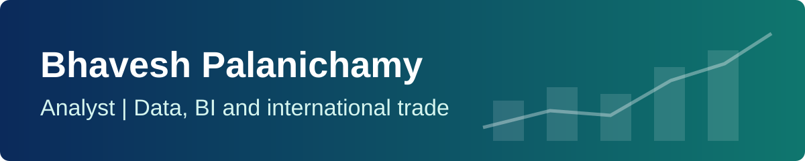

 

## Profile

Business and data analyst working in commercial reporting, demand forecasting and operational performance at a chemicals manufacturer since January 2024. I work across sales, production and supply chain, using SAP, Excel and Power BI for reporting, and Python and SQL for modelling and competitive intelligence. Based in India.

## Experience

### Analyst, TANFAC Industries Limited
*January 2024 – Present*

- **Forecasting:** developed customer-level demand forecasts from purchase order, inventory and logistics data, improving dispatch planning.
- **Commercial reporting:** produced monthly invoice-level P&L reports covering pricing, costs, volumes and contribution margins.
- **Dashboards:** built daily sales dashboards in SAP and Excel by product and customer segment.
- **Root-cause analysis:** analysed delayed and non-compliant orders, and implemented corrective actions that reduced customer complaints by 50%.
- **Operations and strategy:** managed the order lifecycle in SAP, and supported new product evaluation with Python-based competitor benchmarking.

## Featured project

### [International Trade Analytics: India's Export Profile (2014–2023)](https://github.com/Veshy25/trade-analytics)

<table><tr><td width="50%"></td><td width="50%"></td></tr></table>

**How does India's export growth compare with China, Vietnam and Bangladesh?** Built with PostgreSQL, Python and Power BI on UN Comtrade data (Bangladesh: 2015–2018 only).

- **Finding:** in nominal terms, India's exports grew 3.46% a year from 2014 to USD 431.4 billion in 2023, against 4.16% for China and 9.96% for Vietnam.
- **Work:** PostgreSQL analysis with 18 built-in data checks, a five-page Power BI dashboard and written findings.
- **Read next:** [key findings](https://github.com/Veshy25/trade-analytics/blob/main/insights/key_findings.md)

## Skills

     

   

  

## Education

**Monash University — Master of International Business** | July 2022 – Dec 2023 
*CGPA: 3.684 / 4*

**Monash University — Bachelor of Business & Commerce** | Oct 2019 – June 2022 
Double Major: Business Analytics & International Business Management 
*CGPA: 3.520 / 4*

## Certifications

- Data Science & Analytics for Strategic Decisions, Singapore Management University (2026)
- Python for Data Science, AI & Development, IBM / Coursera (2025)
- Tools for Data Science, IBM / Coursera (2025)
